# Manual de usuario — Sistema de Reclutamiento y Selección de RH

Guía pantalla por pantalla del sistema. Las capturas se tomaron con la aplicación real conectada a Supabase (1366 × 768). Todos los nombres y cédulas que aparecen son **ficticios**.

## Contenido

1. [Inicio de sesión](#1-inicio-de-sesión)
2. [Dashboard](#2-dashboard)
3. [Competencias](#3-competencias)
4. [Idiomas](#4-idiomas)
5. [Capacitaciones](#5-capacitaciones)
6. [Puestos](#6-puestos)
7. [Candidatos](#7-candidatos)
8. [Proceso de selección (contratación)](#8-proceso-de-selección-contratación)
9. [Empleados](#9-empleados)
10. [Consulta de candidatos por criterios](#10-consulta-de-candidatos-por-criterios)
11. [Reporte de empleados de nuevo ingreso](#11-reporte-de-empleados-de-nuevo-ingreso)
12. [Diseño responsive](#12-diseño-responsive)

---

## 1. Inicio de sesión

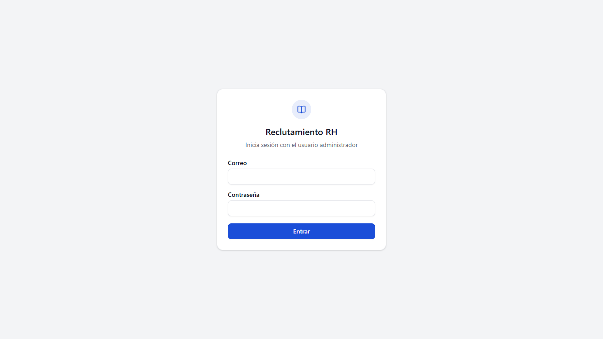

- El sistema solo es accesible para el **usuario administrador**, creado en Supabase Auth.
- Sin sesión iniciada, la base de datos no entrega ni modifica ningún dato (políticas RLS).
- El botón **Salir** de la barra superior cierra la sesión.

## 2. Dashboard

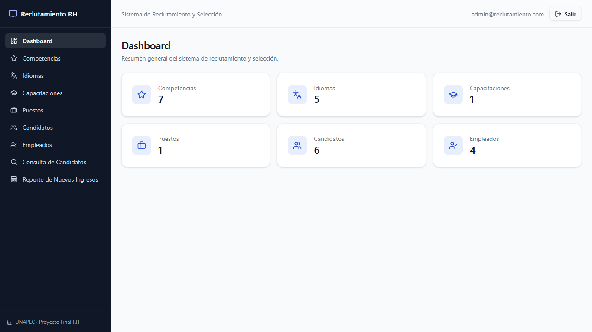

Muestra la cantidad de registros de cada módulo, consultada en tiempo real en la base de datos. Cada tarjeta lleva a su módulo.

El **menú lateral** da acceso a las 9 opciones del sistema: Dashboard, Competencias, Idiomas, Capacitaciones, Puestos, Candidatos, Empleados, Consulta de Candidatos y Reporte de Nuevos Ingresos.

## 3. Competencias

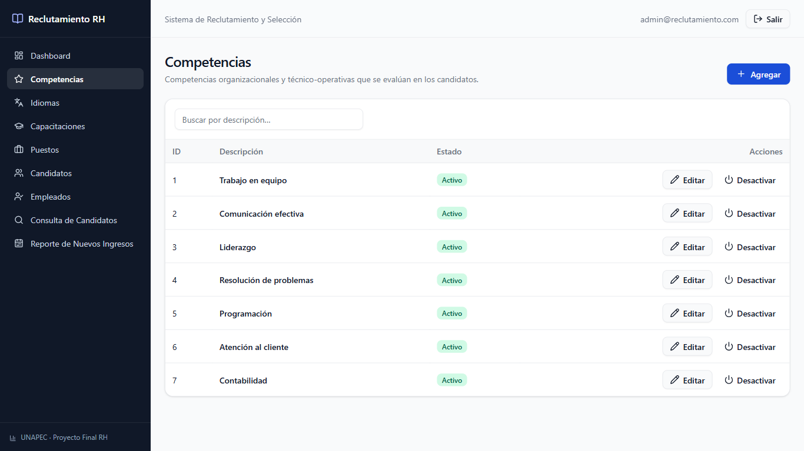

| Dato (presentación) | Campo en pantalla |
|---|---|
| Identificador | ID (autogenerado) |
| Descripción de la competencia | Descripción |
| Estado | Activo / Inactivo |

- **Agregar** abre el formulario de registro; **Editar** permite modificar.
- **Desactivar / Activar** cambia el estado sin borrar el registro. Las competencias inactivas no se ofrecen al registrar candidatos.
- El buscador filtra la tabla por descripción.
- No se permiten descripciones duplicadas (sin importar mayúsculas o minúsculas).

## 4. Idiomas

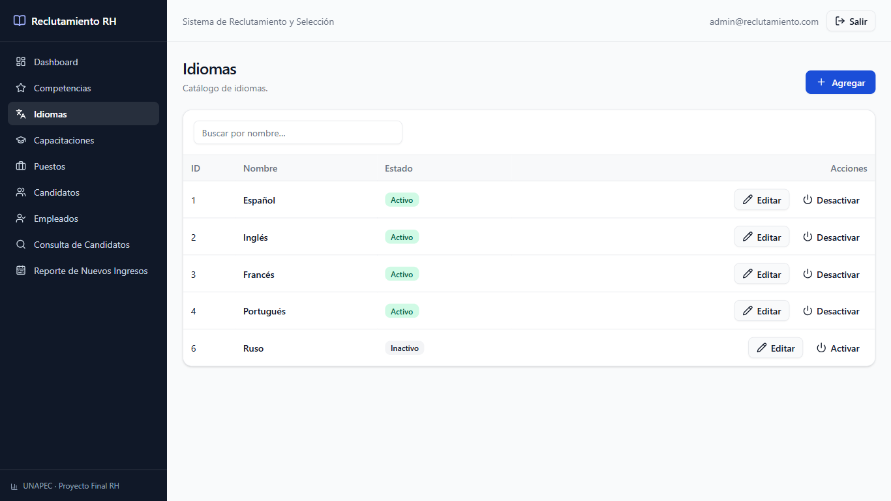

Mismo funcionamiento que Competencias, con los campos **Identificador**, **Nombre** y **Estado**.

## 5. Capacitaciones

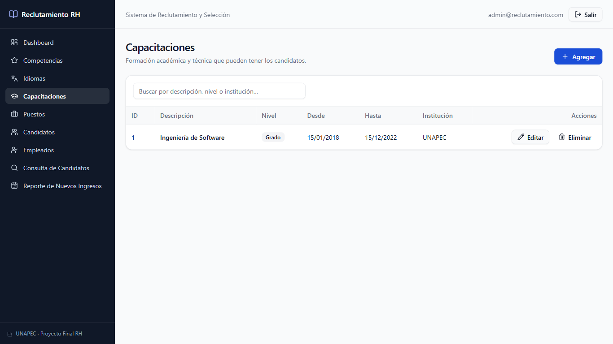

| Dato (presentación) | Campo en pantalla |
|---|---|
| Identificador | ID |
| Descripción | Descripción |
| Nivel | Grado, Postgrado, Maestría, Doctorado, Técnico o Gestión |
| Fecha desde / Fecha hasta | Desde / Hasta |
| Institución | Institución |

**Validación:** la *fecha hasta* no puede ser anterior a la *fecha desde*.
Una capacitación asignada a un candidato no se puede eliminar.

## 6. Puestos

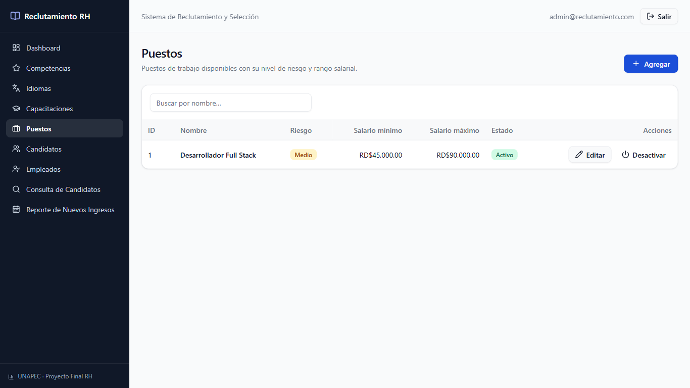

| Dato (presentación) | Campo en pantalla |
|---|---|
| Identificador | ID |
| Nombre | Nombre |
| Nivel de riesgo | Alto / Medio / Bajo (con color) |
| Nivel mínimo / máximo de salario | Salario mínimo / Salario máximo (RD$) |
| Estado | Activo / Inactivo |

Validaciones visibles al guardar el formulario incompleto:

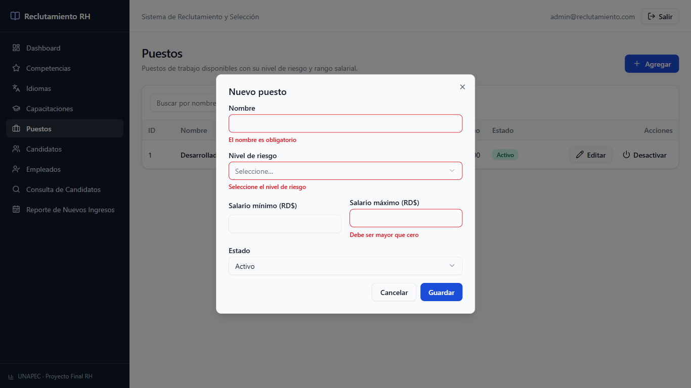

**Regla:** el salario mínimo no puede superar al máximo. La base de datos también lo impide.

## 7. Candidatos

### Listado

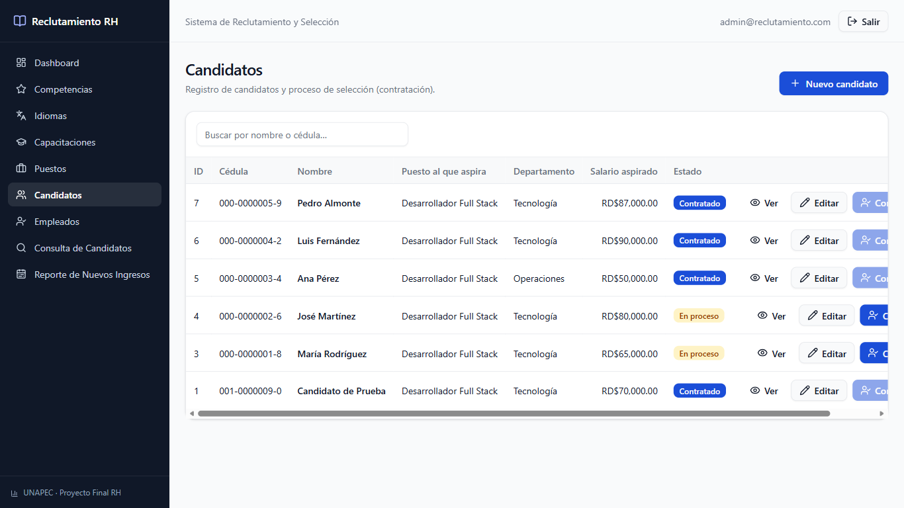

- Búsqueda por nombre o cédula.
- **Estado** del candidato: *En proceso* o *Contratado*.
- Acciones: **Ver** (consulta), **Editar** y **Contratar**.

### Registro y edición

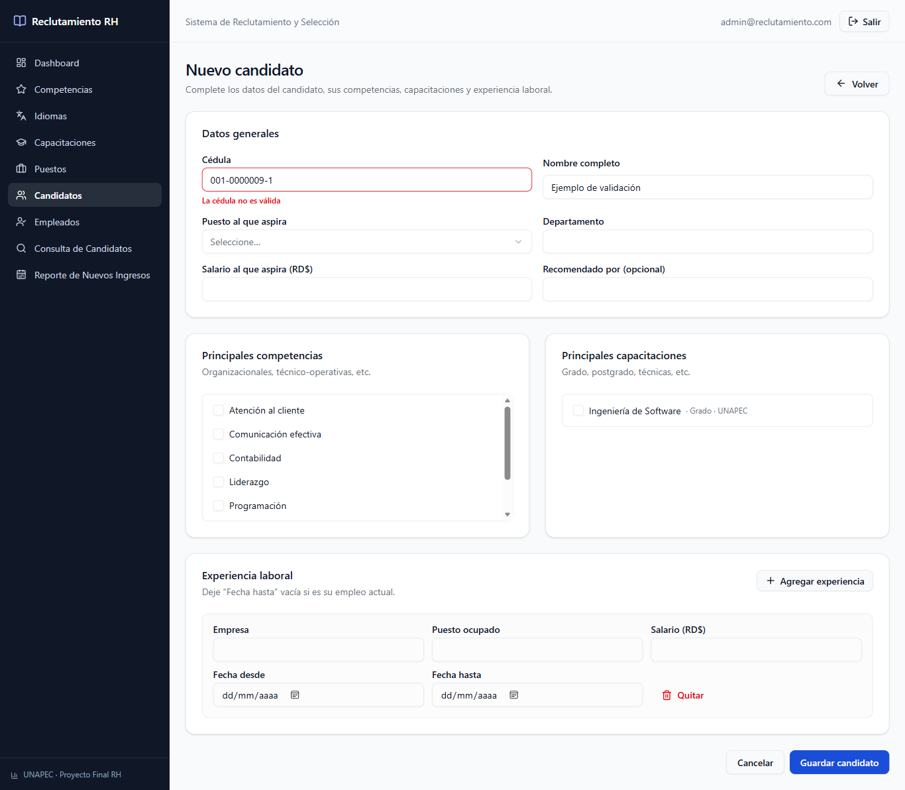

| Dato (presentación) | Cómo se captura |
|---|---|
| Identificador | Autogenerado |
| Cédula | Texto con formato `000-0000000-0`, **validada con el algoritmo oficial** |
| Nombre | Texto |
| Puesto al que aspira | Selección entre los puestos activos |
| Departamento | Texto |
| Salario al que aspira | Monto; se muestra el rango salarial del puesto como referencia |
| Principales competencias | Casillas de selección múltiple (mínimo una) |
| Principales capacitaciones | Casillas de selección múltiple |
| Experiencia laboral | Lista dinámica: **Agregar experiencia** / **Quitar** |
| Recomendado por | Texto opcional |

**Experiencia laboral** (puede haber varias por candidato): Empresa, Puesto ocupado, Fecha desde, Fecha hasta (vacía si es el empleo actual) y Salario.

**Validación de cédula.** Mientras se escribe, el sistema indica si la cédula es válida (✓) o muestra *"La cédula no es válida"*, como en la imagen. El algoritmo:
1. Elimina los guiones y exige 11 dígitos.
2. Multiplica cada dígito por `1, 2, 1, 2, 1, 2, 1, 2, 1, 2, 1`.
3. Si un producto es ≥ 10, suma sus dos dígitos.
4. La cédula es válida si el total es divisible entre 10.

La misma validación existe dentro de PostgreSQL (`validar_cedula`), y la cédula es única: **no se puede guardar un candidato con cédula inválida o repetida** por ninguna vía.

### Consulta (detalle)

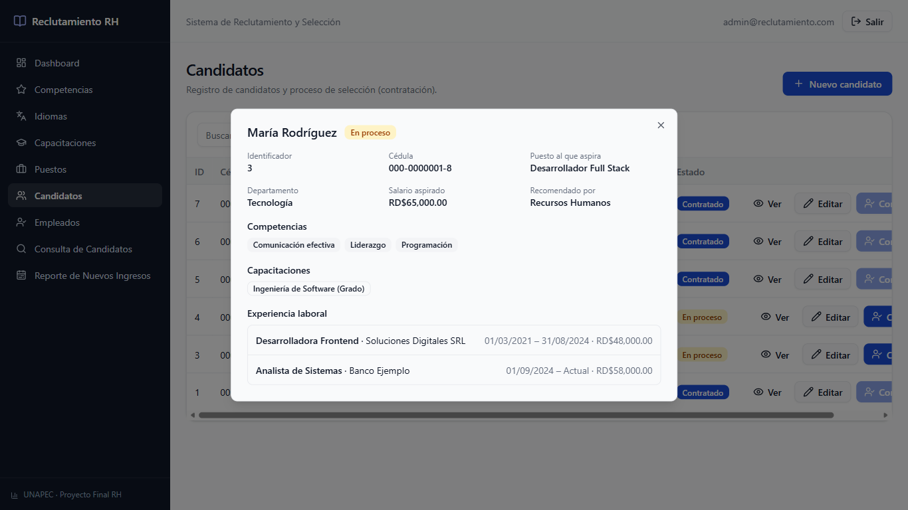

El botón **Ver** muestra todos los datos del candidato con sus competencias, capacitaciones y experiencias laborales.

## 8. Proceso de selección (contratación)

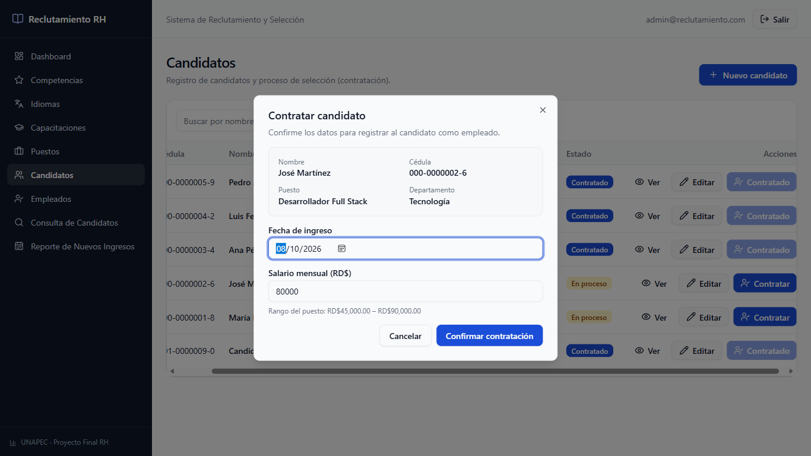

Flujo:
1. En **Candidatos**, presionar **Contratar** en la fila del candidato.
2. El formulario muestra los datos del candidato: nombre, cédula, puesto y departamento.
3. Indicar la **fecha de ingreso** (por defecto, hoy) y el **salario mensual** (por defecto, el aspirado; se muestra el rango del puesto).
4. **Confirmar contratación.**

Al confirmar, la función `contratar_candidato` de PostgreSQL, en **una sola transacción**:
- crea el registro en **Empleados**, y
- cambia el estado del candidato a **Contratado**.

Un candidato **no puede contratarse dos veces**: el botón queda deshabilitado, la función lo rechaza y la base de datos tiene una restricción `UNIQUE` sobre el candidato.

## 9. Empleados

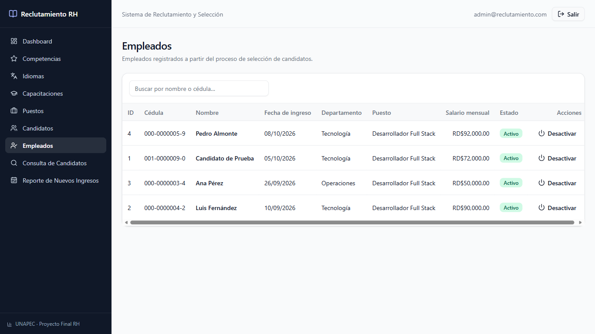

| Dato (presentación) | Columna |
|---|---|
| Identificador | ID |
| Cédula | Cédula |
| Nombre | Nombre |
| Fecha de ingreso | Fecha de ingreso |
| Departamento | Departamento |
| Puesto | Puesto |
| Salario mensual | Salario mensual |
| Estado | Activo / Inactivo (con botón para cambiarlo) |

## 10. Consulta de candidatos por criterios

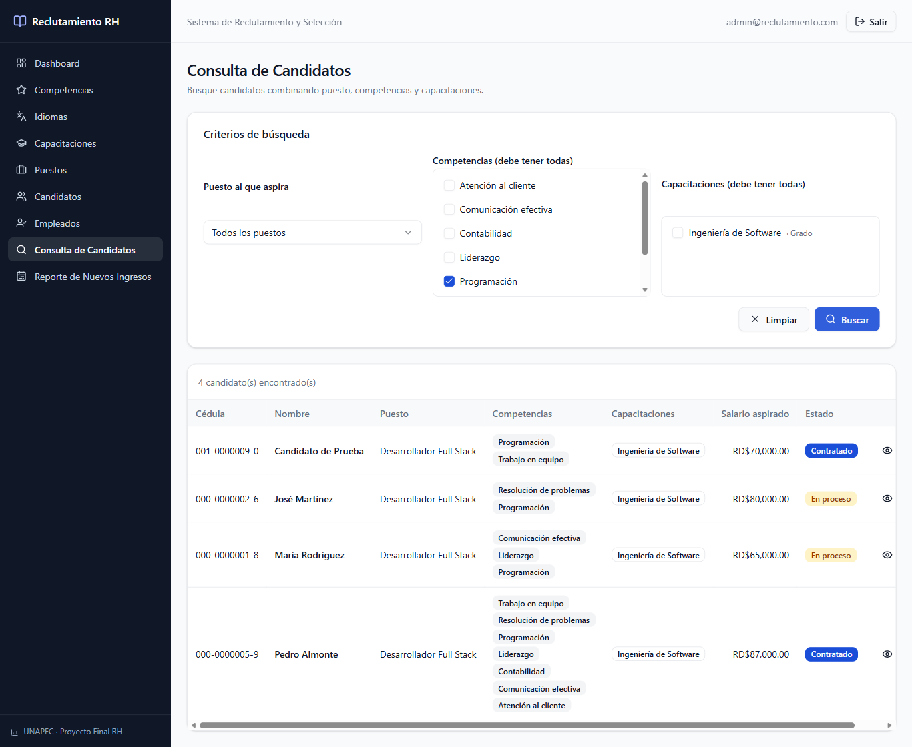

- Filtros combinables: **puesto**, **competencias** y **capacitaciones**.
- Cuando se marcan varias competencias o capacitaciones, el candidato debe tenerlas **todas**.
- **Limpiar** reinicia los filtros. **Ver** abre el detalle del candidato.

En la imagen, el filtro *Programación* encuentra a los 4 candidatos que tienen esa competencia.

## 11. Reporte de empleados de nuevo ingreso

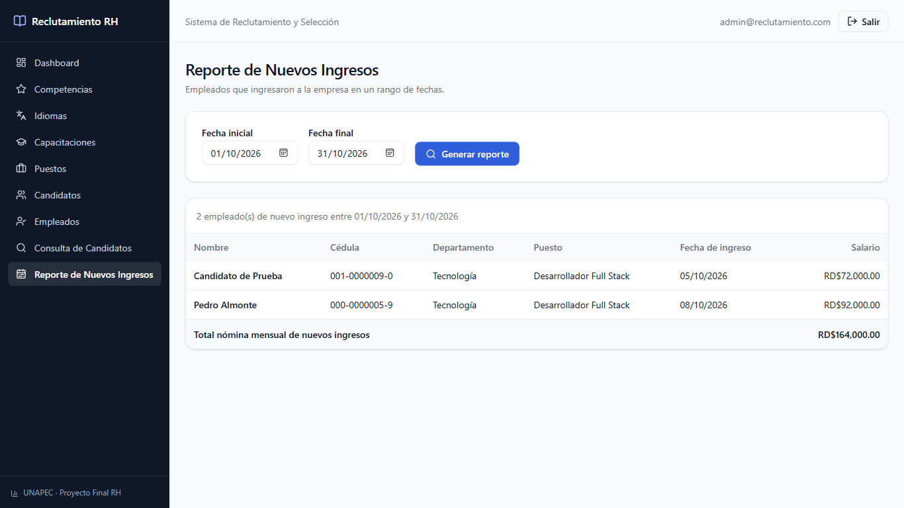

- Se selecciona la **fecha inicial** y la **fecha final** y se presiona **Generar reporte**.
- Muestra nombre, cédula, departamento, puesto, fecha de ingreso y salario de los empleados que ingresaron en ese período, más el **total de la nómina mensual** de esos ingresos.
- La fecha final no puede ser anterior a la inicial.

## 12. Diseño responsive

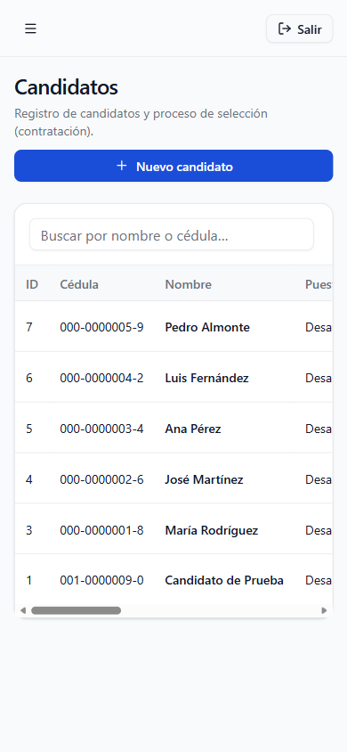

En pantallas pequeñas el menú lateral se oculta detrás del botón ☰ y las tablas se desplazan horizontalmente.
